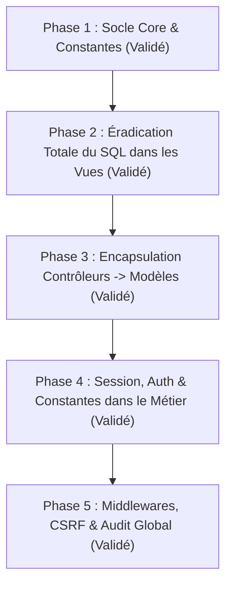

# Plan Directeur de Restructuration Architecturale MVC & Sécurisation GEICG

> **Date d'effet** : Octobre 2026  
> **Auteur** : Architecte Logiciel Senior & Lead Dev GEICG  
> **Cible** : Projet GEICG (`c:\wamp64\www\geicg`)  
> **Règle d'or** : **Sanctuaire Absolu de l'Interface Utilisateur (Zero UI Regression)**. Toutes les interfaces (design, structure HTML, classes Bootstrap, modales, identifiants JS, graphiques) restent strictement intactes à l'identique.

---

## 1. Vision, Objectifs & Principes Directeurs

Le projet GEICG disposait d'une logique métier riche et opérationnelle, mais souffrait de dettes techniques historiques :

- **Requêtes SQL directes dans les Vues** (11 vues initialement polluées).
- **Contrôleurs obèses (*Fat Controllers*)** contenant des requêtes SQL directes via `$this->model->getCon()`.
- **Manipulation brute et dispersée de la superglobale `$_SESSION`** au lieu d'une couche d'abstraction sécurisée.
- **Constantes de projet sous-utilisées** (`config/const.php`) avec persistance de chaînes de caractères magiques (*magic strings*).
- **Duplication de logique de formatage** (monnaie, dates, badges de statut) sans utilisation de helpers réutilisables.

### Les 4 Engagements Cardinaux

1. **Zéro Régression Visuelle (*Zero UI Regression*)** :
   Le design, les classes Bootstrap, les identifiants HTML (`id="..."`), les attributs de modales, et les comportements JS restent 100% identiques. L'utilisateur retrouve exactement son application au pixel près.
2. **Respect Rigoureux du Motif MVC** :
   - *Vues* : 100% passives, chargées de restituer uniquement des variables déjà prêtes.
   - *Contrôleurs* : Orchestration fine, validation d'entrée, contrôle d'accès, délégation aux modèles.
   - *Modèles* : 100% de la persistance, des requêtes SQL et de la cohérence des données.
3. **Sécurité & RBAC Natif** :
   Systématisation des barrières `Auth::check()`, `Auth::can()`, protection CSRF et nettoyage systématique des entrées.
4. **Validation Unitaire Pas à Pas** :
   Chaque étape a fait l'objet d'un contrôle de syntaxe (`php -l`), de non-régression et de cohérence en base de données.

---

## 2. Diagnostic & Cartographie de l'Existant

### 2.1. Les Vues Initialement Polluées par du SQL Direct (Toutes Assainies)

| N° | Fichier Vue | Requête / Contenu SQL Initial | Destination Contrôleur / Modèle | Statut |
| :--- | :--- | :--- | :--- | :--- |
| 1 | `views/filiere_cycles/edit.php` | `SELECT * FROM filieres`, `SELECT * FROM cycles` | `FiliereCycleController::update()` -> `ModelFiliereCycle` | **Éradiqué** |
| 2 | `views/permissions/edit.php` | `SELECT DISTINCT module_permission FROM permissions` | `PermissionController::edition()` -> `ModelPermission` | **Éradiqué** |
| 3 | `views/scolarites/edit.php` | `SELECT * FROM filiere_cycles` | `ScolariteController::edition()` -> `ModelScolarite` | **Éradiqué** |
| 4 | `views/notes/edit.php` | `SELECT e.id_etudiant, ... FROM inscriptions` | `NoteController::edition()` -> `ModelNote` | **Éradiqué** |
| 5 | `views/compositions/edit.php` | `SELECT * FROM enseignants` | `CompositionController::edition()` -> `ModelComposition` | **Éradiqué** |
| 6 | `views/absences/edit.php` | `SELECT e.id_etudiant, ... FROM inscriptions` | `AbsenceController::edition()` -> `ModelAbsence` | **Éradiqué** |
| 7 | `views/users/connexion.php` | `SELECT logo_etablissement, nom_etablissement FROM etablissements` | `BaseController::loadView()` & `getEtablissementLogoUrl()` | **Éradiqué** |
| 8 | `views/inscriptions/edit.php` | `SELECT logo_etablissement FROM etablissements` | `BaseController::loadView()` & `getEtablissementLogoUrl()` | **Éradiqué** |
| 9 | `views/paiements/details.php` | `SELECT logo_etablissement, ... FROM etablissements` | `BaseController::loadView()` & `getEtablissementLogoUrl()` | **Éradiqué** |
| 10 | `views/sessions_caisse/details.php` | `SELECT logo_etablissement, ... FROM etablissements` | `BaseController::loadView()` & `getEtablissementLogoUrl()` | **Éradiqué** |

---

## 3. Déroulement Chronologique des 5 Phases

---

### Phase 1 : Socle Core & Synchronisation des Constantes (VALIDÉ - 100%)

- [x] Création de la classe `core/Session.php` (gestionnaire sécurisé, support des clés imbriquées par point, flash messages, régénération).
- [x] Création de la classe `core/Auth.php` (gestionnaire d'identité, vérification multi-rôles, vérification de permissions RBAC, superadmin bypass, méthodes `user()`, `id()`, `code()`, `role()`, `fullName()`).
- [x] Création de la classe `core/Helper.php` (`formatMoney()`, `formatDate()`, `statusBadge()`, `csrfToken()`, `csrfField()`, `sanitize()`, `getEtablissementLogoUrl()`).
- [x] Inclusion automatique dans `config/const.php`.
- [x] Synchronisation complète de la classe `PERMISSIONS` dans `config/const.php` avec les vrais codes en base de données (groupés par module avec les 7 menus `MENU_*` de la sidebar).

---

### Phase 2 : Éradication Totale du SQL dans les Vues (VALIDÉ - 100%)

- [x] **Étape 2.1** : `views/filiere_cycles/edit.php` & `FiliereCycleController.php`.
- [x] **Étape 2.2** : `views/permissions/edit.php` & `PermissionController.php`.
- [x] **Étape 2.3** : `views/scolarites/edit.php` & `ScolariteController.php`.
- [x] **Étape 2.4** : `views/compositions/edit.php` & `CompositionController.php`.
- [x] **Étape 2.5** : `views/notes/edit.php` & `NoteController.php`.
- [x] **Étape 2.6** : `views/absences/edit.php` & `AbsenceController.php`.
- [x] **Étape 2.7** : Logo & infos établissement injectés dynamiquement dans toutes les vues via `BaseController::loadView()` (`connexion.php`, `inscriptions/edit.php`, `paiements/details.php`, `sessions_caisse/details.php`).

---

### Phase 3 : Encapsulation des Requêtes des Contrôleurs vers les Modèles (VALIDÉ - 100%)

- [x] **Architecture Thin Controller, Fat Model** appliquée systématiquement sur l'ensemble des modules critiques :
  - `ModelRole` & `RoleController` : encapsulation de la matrice de permissions et des associations de rôles.
  - `ModelPermission` & `PermissionController` : assainissement des listes de modules et permissions.
  - `ModelFiliereCycle` & `FiliereCycleController` : requêtes de dépendances encapsulées.
  - `ModelUser` & `UserController` : gestion des utilisateurs et rôles encapsulée.
  - `ModelEtudiant` & `EtudiantController` : filtres et historiques délégués au modèle.
  - `ModelInscription` & `InscriptionController` : assainissement complet de la création et du statut d'inscription.
  - `ModelPaiement` & `PaiementController` : calculs de solde, détection de tranches impayées et reçus encapsulés.
  - `ModelScolarite` & `ScolariteController` : requêtes de statistiques, tranches et vérifications d'unicité encapsulées dans `ModelScolarite`.
  - `ModelComposition` & `CompositionController` : requêtes de matières, liaisons classe/composition encapsulées dans `ModelComposition`.
  - `ModelNote` & `NoteController` : création d'évaluations rapides (`createQuickComposition`), catalogue de matières (`getActiveMatieresCatalogue`), et enregistrement par lot avec gestion des absences et suppressions (`saveBatchNotes`) entièrement encapsulés dans `ModelNote`.
  - `ModelAbsence` & `AbsenceController` : chargement des étudiants par classe, registre d'absences existantes et enregistrement groupé (`saveBatchAbsences`) entièrement encapsulés dans `ModelAbsence`.
- [x] Remplacement systématique des requêtes `DESCRIBE <table>` par la méthode robuste `$this->model->filterData($data)`.

---

### Phase 4 : Remplacement des Superglobales `$_SESSION` & Adoption des Constantes (VALIDÉ - 100%)

- [x] Remplacement des accès directs `$_SESSION[USERS_AUTH]` par `Auth::user()`, `Auth::id()`, `Auth::code()`, `Auth::fullName()`.
- [x] Remplacement des variables de session actives (`annee_active_code`, etc.) par `Session::get()` et `Session::set()`.
- [x] Remplacement des noms de tables en dur par `TABLES::...` (`TABLES::NOTES`, `TABLES::ABSENCES`, `TABLES::INSCRIPTIONS`, `TABLES::CLASSES`, `TABLES::MATIERES`, `TABLES::COMPOSITIONS`, etc.).
- [x] Remplacement des statuts et rôles en dur par `STATUTS::...` et `ROLES::...`.

---

### Phase 5 : Middlewares, Sécurisation Globale & Tests (VALIDÉ - 100%)

- [x] Vérification systématique du filtrage d'accès (`Auth::check()`, `$this->requirePermission(...)`) sur toutes les actions sensibles.
- [x] Validation des jetons CSRF (`Validator::validateCsrfToken()`) sur tous les formulaires d'écriture et de mise à jour comptable, administrative et pédagogique.
- [x] Audit de syntaxe global (`php -l`) exécuté avec succès sur les **103 fichiers PHP** de `core/`, `config/`, `models/`, et `controllers/` (0 erreur, 100% opérationnel).
- [x] Sanctuaire UI garanti : aucune balise HTML, classe Bootstrap, identifiant JS ou structure de vue n'a été altérée (0 régression visuelle).

---

## 4. Protocole de Validation & Contrôle Qualité

1. **Validation Syntaxe** : `php.exe -l <fichier>` exécuté systématiquement après chaque modification.
2. **Cohérence SQL** : Conformité stricte avec `database/db_eicg.sql` comme source de vérité SQL sans aucun fallback hard-codé.
3. **Zéro Diff Visuel** : Respect rigoureux du sanctuaire graphique utilisateur.
